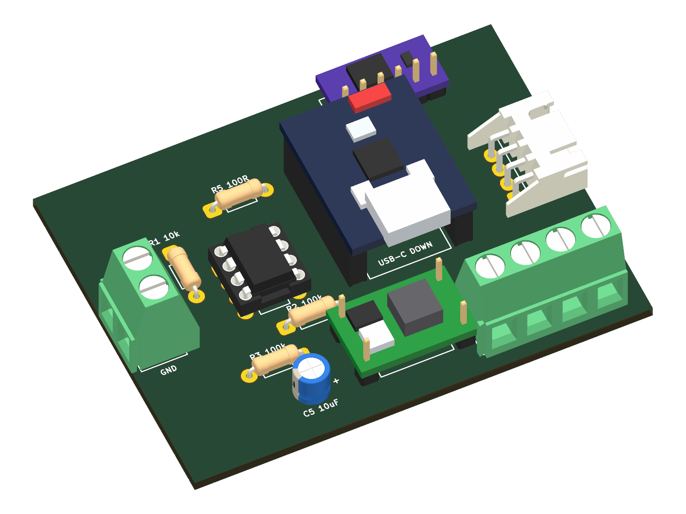
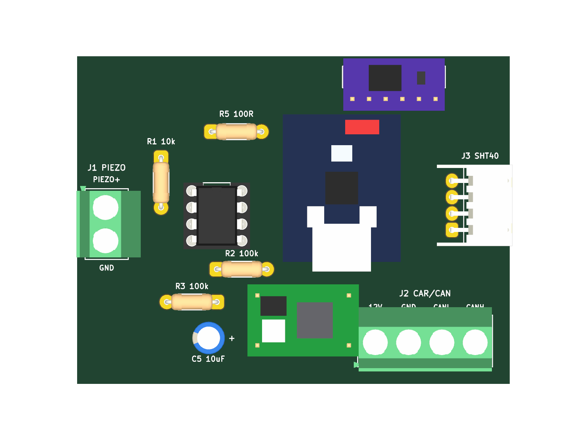
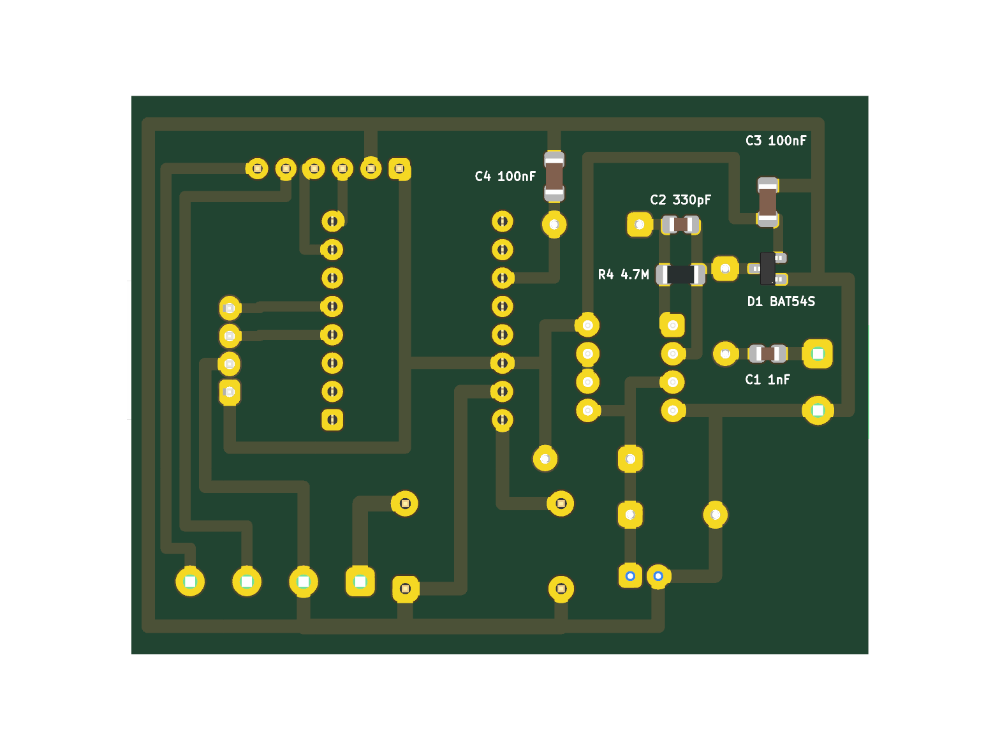

# TechBIT Hardware (`scheme`) — Плата колісного вузла

Апаратна частина системи моніторингу вібрації, стану гальм/підшипників та температури коліс автомобіля **TechBIT**.  
Ця гілка (`scheme`) містить **лише апаратну частину (KiCad 10 PCB, 3D-моделі, генератори та файли для виготовлення)** — веб-додаток знаходиться у гілках `main` / `web-development`.



| Вигляд зверху (`F.Cu` — модулі та THT) | Вигляд знизу (`B.Cu` — SMD на міді) |
|---|---|
|  |  |

---

## Структура репозиторію

```text
.
├── kicad/                                      # Проєкт KiCad 10
│   ├── Wheel_Sensor_Amplifier.kicad_pro        # Файл проєкту KiCad 10
│   ├── Wheel_Sensor_Amplifier.kicad_sch        # Принципова схема та перелік зв'язків
│   ├── Wheel_Sensor_Amplifier.kicad_pcb        # Розводка плати (66 × 50 мм, 1 шар B.Cu)
│   └── Wheel_Sensor_Amplifier_Panel_A4.kicad_pcb  # Панель 3×5 (15 плат на аркуш A4)
├── 3dmodels/                                   # Локальні 3D-моделі модулів (.wrl)
├── renders/                                    # 3D-рендери та читабельна схема розмітки (.png)
├── print/                                      # Готові PDF 1:1 для ЛУТ, УФ-маски та монтажу
├── scripts/                                    # Python-скрипти генерації проєкту і макетів
│   ├── generate_project.py                     # Генератор KiCad-проєкту (single + 15x panel)
│   ├── make_plate_151x102.py                   # Генератор листів під текстоліт 151×102 мм
│   ├── make_a4_mixed_sheet.py                  # Генератор змішаного аркуша A4 (5 комплектів)
│   └── make_top_half_stencils.py               # Генератор УФ-маски на верхню половину A4
├── .gitignore
├── LICENSE
└── README.md
```

---

## Технічні характеристики плати (`Wheel Sensor Amplifier`)

- **Габарити однієї плати:** `66.0 × 50.0 мм` (оптимально для розміщення `2×2 = 4` плат на заготовці `151×102 мм` або `3×5 = 15` плат на A4).
- **Топологія:** **одностороння мідь (`B.Cu`)**, розведена без перемичок та без масивної заливки `GND` — розрахована під домашнє травлення (ЛУТ + лимонна кислота / перекис водню або хлорне залізо).
- **Гідроізоляція під заливку компаундом:** усі силові, шинні та сенсорні інтерфейси (`J1`, `J2`, `J3`) винесені кутовими роз'ємами по периметру для зручного заливання плати епоксидною смолою.
- **Паяльна маска:** розширення вікон `pad_to_mask_clearance = 0.15 мм`, суцільне заповнення контактних площадок на фотошаблонах (`B.Mask`).

---

## Склад компонентів (BOM)

### Верхня сторона (`F.Cu` — вивідні компоненти, модулі та роз'єми)
| Позиція | Компонент / Модуль | Номінал / Тип | Призначення |
|---|---|---|---|
| `U2` | Мікроконтролер | `ESP32-C3 SuperMini` | Оцифровка АЦП, I2C, CAN/TWAI (`USB-C` донизу) |
| `U1` | Операційний підсилювач | `MCP6002-I/P` (панелька `DIP-8`) | Зарядовий підсилювач ($K \approx 3$) + буфер |
| `MOD1` | DC-DC понижувач | `Mini360` (`12V → 5V`) | Живлення вузла від бортмережі авто |
| `MOD2` | CAN-трансивер | `SN65HVD230` (3.3V, 6-pin) | Інтерфейс CAN-шини (`CANH` / `CANL`) |
| `J1` | Клемник датчика вібрації | `15EDGR-5.08-02P` / `KF301-2P` (кутовий) | Вхід п'єзодатчика (`1=PIEZO+`, `2=GND`) |
| `J2` | Клемник живлення та CAN | `15EDGR-5.08-04P` / `KF301-4P` (кутовий) | Автомагістраль (`1=+12V`, `2=GND`, `3=CAN_L`, `4=CAN_H`) |
| `J3` | Роз'єм датчика температури | `JST-XH S4B-XH-A` (4-pin, кутовий 2.5 мм) | Вологостійкий датчик `GY-SHT40` (`1=3V3`, `2=GND`, `3=SDA`, `4=SCL`) |
| `R1` | Резистор THT 0.25W | `10 kΩ` | Обмеження вхідного струму ОП |
| `R2`, `R3` | Резистори THT 0.25W | `100 kΩ` (2 шт.) | Дільник опорної напруги `1.65 В` (`Vref`) |
| `R5` | Резистор THT 0.25W | `100 Ω` | Ізолюючий резистор перед ФНЧ та АЦП |
| `C5` | Конденсатор електролітичний | `10 µF` (радиальний D5/P2.5) | Фільтрація `Vref` (`+` до `VREF_1V65`) |

### Нижня сторона (`B.Cu` — SMD-монтаж на мідні доріжки)
| Позиція | Корпус | Номінал | Призначення |
|---|---|---|---|
| `D1` | `SOT-23` | `BAT54S` | Здвоєний діод Шотткі (захист входу від сплесків) |
| `C1` | `0805` | `1 nF` (NP0/C0G) | Вхідний розділовий конденсатор |
| `C2` | `0805` | `330 pF` (NP0/C0G, 50V) | Конденсатор зворотного зв'язку ($K = C_1/C_2 \approx 3$) |
| `R4` | `1206` | `4.7 MΩ` | Розрядний резистор зарядового інтегратора |
| `C3` | `1206` | `100 nF` | Блокування живлення `+3V3` біля `U1` |
| `C4` | `1206` | `100 nF` | ФНЧ антиаліасингу на вході АЦП (`R5 + C4`) |

---

## Розпіновка `ESP32-C3 SuperMini` (`U2`)

| Пін модуля | Сигнал (Net) | Підключення |
|---|---|---|
| Pin 16 (`5V`) | `+5V_BUCK` | Вихід `MOD1` (`Mini360`) |
| Pin 15 (`GND`) | `GND` | Загальна земля |
| Pin 14 (`3V3`) | `+3V3` | Живлення `U1`, `MOD2`, `J3`, `R2`, `D1` |
| Pin 11 | `ADC_SIGNAL` | Аналоговий вихід каскаду (`R5` / `C4`) |
| Pin 8 | `CAN_TX` | `MOD2` pin 3 |
| Pin 7 | `CAN_RX` | `MOD2` pin 4 |
| Pin 5 | `I2C_SCL` | `J3` pin 4 (`GY-SHT40 SCL`) |
| Pin 4 | `I2C_SDA` | `J3` pin 3 (`GY-SHT40 SDA`) |

---

## Свердління отворів

| Діаметр свердла | К-сть отворів (на 1 плату) | Елементи |
|---|---|---|
| **0.8 мм** | 40 | `R1, R2, R3, R5`, `C5`, панелька `U1` (`DIP-8`), гребінки `U2` і `MOD2` |
| **0.9 мм** | 4 | Боковий роз'єм `J3` (`JST-XH`) |
| **1.0 мм** | 4 | Контактні штирі `MOD1` (`Mini360`) |
| **1.3 мм** | 6 | Силові/шинні клемники `J1` і `J2` (`15EDGR-5.08` / `KF301`) |

---

## Файли для друку та виготовлення ([`print/`](print/))

> [!IMPORTANT]
> Друкуйте всі PDF **строго в масштабі `100%` / «Фактичний розмір»** (`Actual Size`). Вимикайте *Fit to Page* та *Borderless* (інакше драйвер розтягне плату на 2–3% і отвори не зійдуться). Перед перенесенням перевірте контрольні лінійки на аркуші (`150 мм` / `100 мм`).

| Файл | Призначення |
|---|---|
| `Plate_151x102_PagePro1350W_A4.pdf` | Оптимізовано під заготовку **`151×102 мм`** (4 плати `2×2`) та поля `≥ 4 мм`: мідь, дзеркальний верх, нижнє SMD-маркування, комбо-аркуш та УФ-маска |
| `SolderMask_UV_Film_Plate_151x102_A4.pdf` | Фотошаблони УФ паяльної маски під пластину `151×102 мм` (тонером вниз до міді + дзеркальний варіант) |
| `SolderMask_UV_Top_Half_A4.pdf` | УФ-маска, розміщена **тільки на верхній половині A4** (економія плівки: 2 плати, 4 плати `2×2`, або 2 пластини) |
| `A4_Mixed_Top_Bottom_Copper_5sets.pdf` | Змішаний аркуш A4: 5 повних комплектів (верх + мідь + низ SMD) + аркуш маркування |
| `Assembly_Guide_Readable_A4.pdf` | Читабельна карта монтажу та пайки (3 сторінки) |
| `LUT_Bottom_Copper_Max_Panel_15x_A4.pdf` / `_Single_A4.pdf` | Мідні доріжки `B.Cu` для ЛУТ (панель 15× або 1 плата) |
| `LUT_Top_Silkscreen_Transfer_Mirrored_15x_A4.pdf` / `_Single_A4.pdf` | Віддзеркалена верхня розмітка `F.SilkS` для переносу праскою |
| `LUT_Bottom_SMD_Markings_Single_A4.pdf` | Маркування SMD знизу (`B.SilkS`) |
| `SolderMask_UV_Film_15x_A4.pdf` / `_Single_A4.pdf` | Фотошаблони УФ-маски на панель 15× або 1 плату |

---

## Перегенерація та калібрування під принтер

Для повторної генерації файлів потрібні **Python 3**, **KiCad 10 (`kicad-cli`)**, **Google Chrome** (headless PDF) та `pypdf`:

```bash
# З кореня репозиторію:

# 1. Перегенерувати проєкт KiCad (одиночна плата, 15x панель, схема)
python3 scripts/generate_project.py

# 2. Перегенерувати аркуші для друку A4
python3 scripts/make_a4_mixed_sheet.py
python3 scripts/make_top_half_stencils.py

# 3. Перегенерувати аркуші під пластину 151x102 мм (з поправкою масштабу принтера у %)
python3 scripts/make_plate_151x102.py --sx 100.0 --sy 100.0
python3 scripts/make_plate_151x102.py --mask --sx 100.0 --sy 100.0
```
