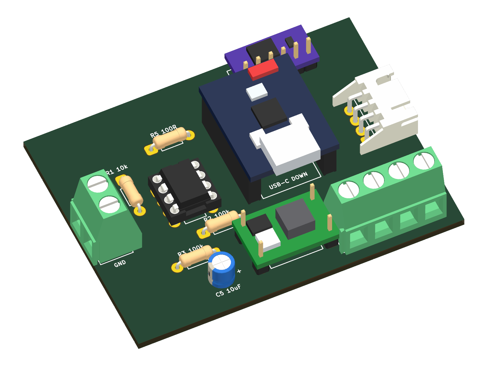
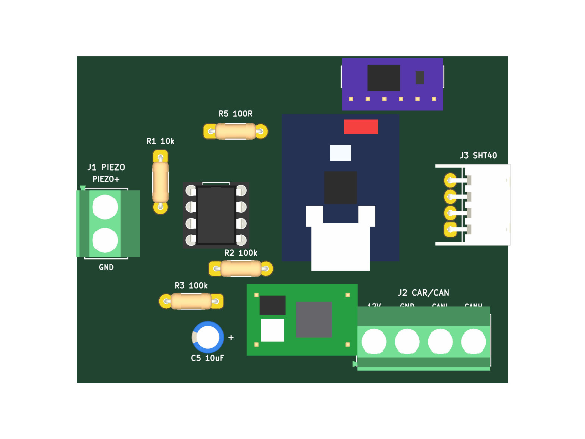
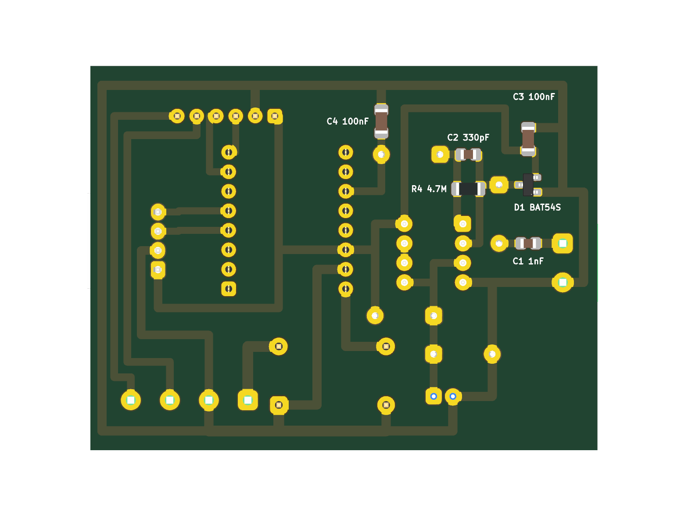
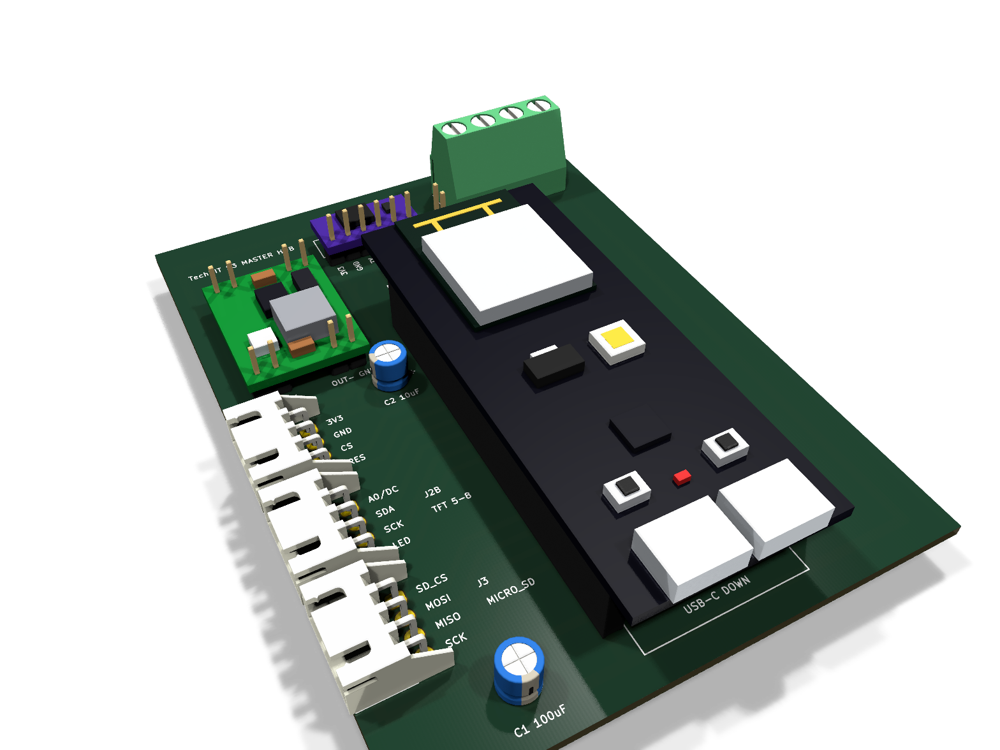
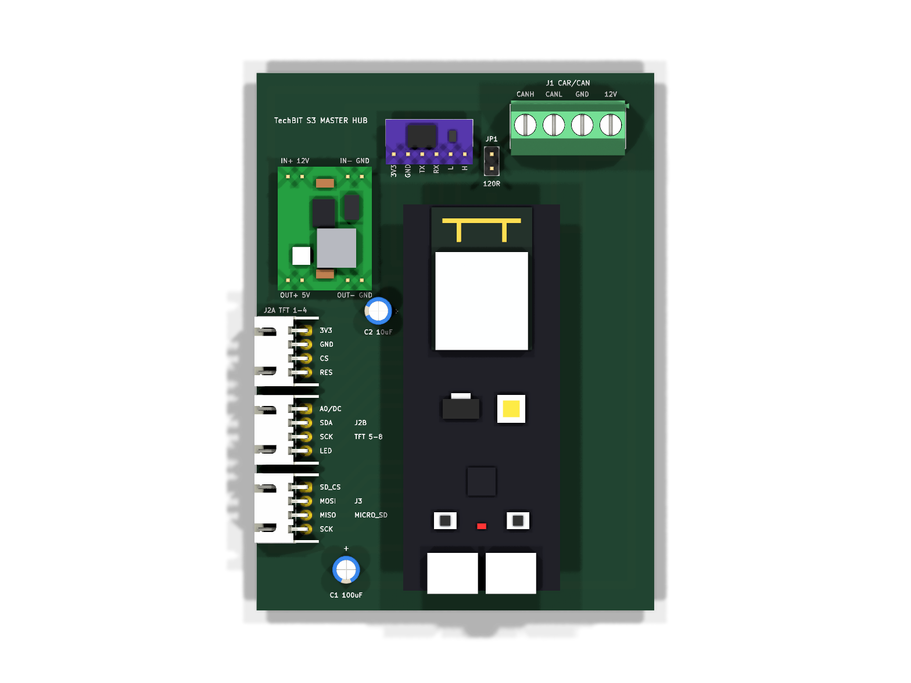
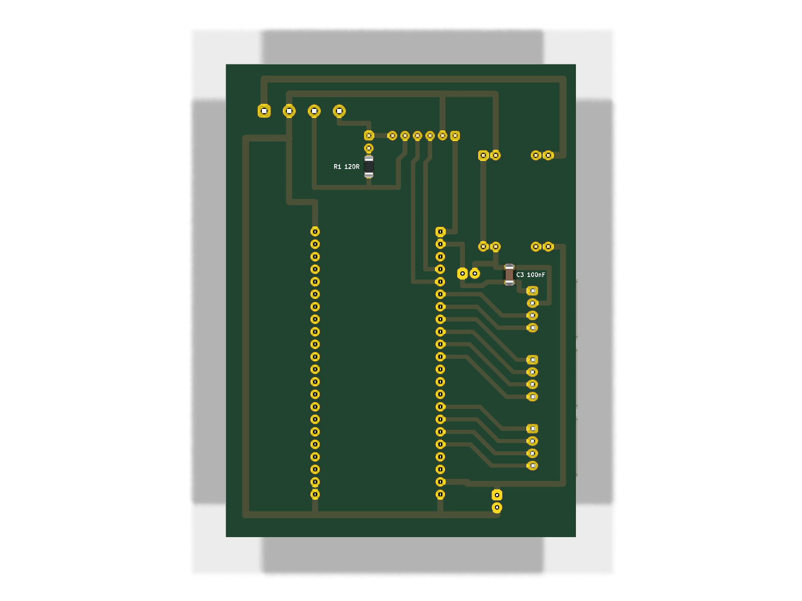
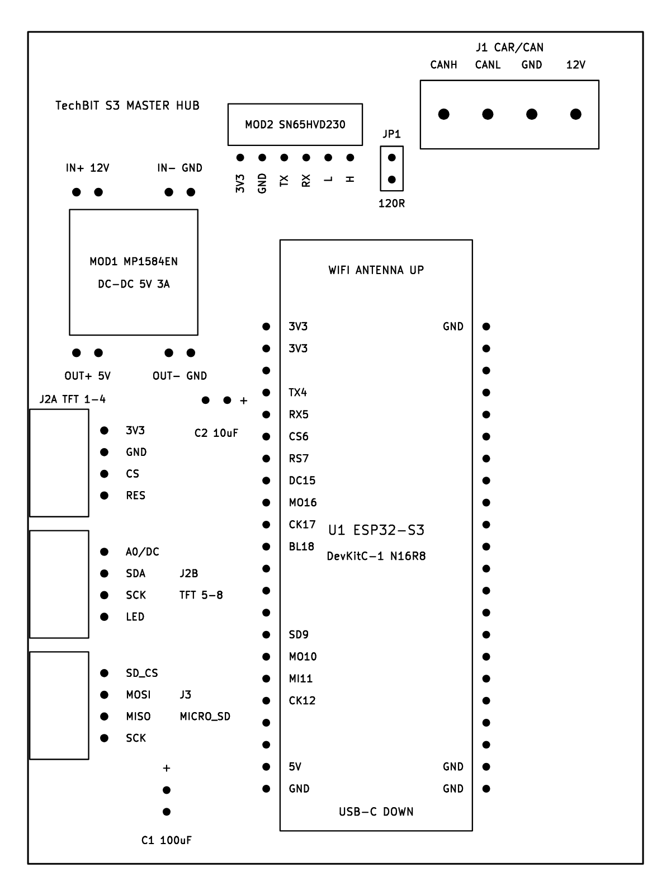

# TechBIT Hardware — Апаратна частина (колісний вузол + головний блок `ESP32-S3`)

Апаратна частина системи моніторингу вібрації, стану гальм/підшипників та температури коліс автомобіля **TechBIT** (**KiCad 10 PCB**, **3D-моделі `.wrl`**, **генератори** та **PDF 1:1 для ЛУТ і УФ-маски**).  
Нижче описані обидві плати системи:
1. **Плата колісного вузла (`Wheel_Sensor_Amplifier`, `66 × 50 мм`)** — `ESP32-C3 SuperMini` + зарядовий підсилювач `MCP6002` + `GY-SHT40` + `CAN`.
2. **Плата головного блоку в кабіні (`S3_Master_Hub`, `71 × 96 мм`)** — `ESP32-S3-DevKitC-1 N16R8` + `CAN (SN65HVD230 + 120 Ω)` + круглий `1.28" GC9A01 SPI TFT` + `microSD`.

---

## 1. Плата колісного вузла (`Wheel_Sensor_Amplifier`)



| Вигляд зверху (`F.Cu` — модулі та THT) | Вигляд знизу (`B.Cu` — SMD на міді) |
|---|---|
|  |  |

---

## Структура папки `hardware/`

```text
hardware/
├── kicad/                                      # Проєкти KiCad 10
│   ├── Wheel_Sensor_Amplifier.kicad_pro        # Проєкт колісного вузла
│   ├── Wheel_Sensor_Amplifier.kicad_sch        # Принципова схема колісного вузла
│   ├── Wheel_Sensor_Amplifier.kicad_pcb        # Розводка (66 × 50 мм, 1 шар B.Cu)
│   ├── Wheel_Sensor_Amplifier_Panel_A4.kicad_pcb  # Панель 3×5 (15 плат на аркуш A4)
│   ├── S3_Master_Hub.kicad_pro                 # Проєкт головного блоку ESP32-S3
│   ├── S3_Master_Hub.kicad_sch                 # Принципова схема та розпіновка S3 Master
│   ├── S3_Master_Hub.kicad_pcb                 # Розводка (71 × 96 мм, 1 шар B.Cu)
│   └── S3_Master_Hub_Panel_A4.kicad_pcb        # Панель 2×3 (6 плат на аркуш A4)
├── 3dmodels/                                   # Локальні 3D-моделі модулів (.wrl)
├── renders/                                    # 3D-рендери та читабельні схеми розмітки (.png)
├── print/                                      # Готові PDF 1:1 для ЛУТ, УФ-маски та монтажу
├── scripts/                                    # Python-скрипти генерації проєктів і макетів
│   ├── generate_project.py                     # Генератор колісного вузла (single + 15x panel)
│   ├── make_plate_151x102.py                   # Аркуші під текстоліт 151×102 мм (колісний вузол)
│   ├── make_a4_mixed_sheet.py                  # Змішаний аркуш A4 (5 комплектів колісного вузла)
│   ├── make_top_half_stencils.py               # УФ-маска на верхню половину A4 (колісний вузол)
│   ├── generate_s3_master.py                   # Генератор головного блоку S3_Master_Hub (single + 6x panel)
│   └── make_s3_master_prints.py                # Генератор PDF 1:1, інструкції та 3D-рендерів S3_Master_Hub
└── README.md
```

---

## Технічні характеристики плати (`Wheel Sensor Amplifier`)

- **Габарити однієї плати:** `66.0 × 50.0 мм` (оптимально для розміщення `2×2 = 4` плат на заготовці `151×102 мм` або `3×5 = 15` плат на A4).
- **Топологія:** **одностороння мідь (`B.Cu`)**, розведена без перемичок та без масивної заливки `GND` — розрахована під домашнє травлення (ЛУТ + лимонна кислота / перекис водню або хлорне залізо).
- **Гідроізоляція під заливку компаундом:** усі силові, шинні та сенсорні інтерфейси (`J1`, `J2`, `J3`) винесені кутовими роз'ємами по периметру для зручного заливання плати епоксидною смолою.
- **Паяльна маска:** розширення вікон `pad_to_mask_clearance = 0.15 мм`, суцільне заповнення контактних площадок на фотошаблонах (`B.Mask`).

---

## Склад компонентів (BOM)

### Верхня сторона (`F.Cu` — вивідні компоненти, модулі та роз'єми)
| Позиція | Компонент / Модуль | Номінал / Тип | Призначення |
|---|---|---|---|
| `U2` | Мікроконтролер | `ESP32-C3 SuperMini` | Оцифровка АЦП, I2C, CAN/TWAI (`USB-C` донизу) |
| `U1` | Операційний підсилювач | `MCP6002-I/P` (панелька `DIP-8`) | Зарядовий підсилювач ($K \approx 3$) + буфер |
| `MOD1` | DC-DC понижувач | `Mini360` (`12V → 5V`) | Живлення вузла від бортмережі авто |
| `MOD2` | CAN-трансивер | `SN65HVD230` (3.3V, 6-pin) | Інтерфейс CAN-шини (`CANH` / `CANL`) |
| `J1` | Клемник датчика вібрації | `15EDGR-5.08-02P` / `KF301-2P` (кутовий) | Вхід п'єзодатчика (`1=PIEZO+`, `2=GND`) |
| `J2` | Клемник живлення та CAN | `15EDGR-5.08-04P` / `KF301-4P` (кутовий) | Автомагістраль (`1=+12V`, `2=GND`, `3=CAN_L`, `4=CAN_H`) |
| `J3` | Роз'єм датчика температури | `JST-XH S4B-XH-A` (4-pin, кутовий 2.5 мм) | Вологостійкий датчик `GY-SHT40` (`1=3V3`, `2=GND`, `3=SDA`, `4=SCL`) |
| `R1` | Резистор THT 0.25W | `10 kΩ` | Обмеження вхідного струму ОП |
| `R2`, `R3` | Резистори THT 0.25W | `100 kΩ` (2 шт.) | Дільник опорної напруги `1.65 В` (`Vref`) |
| `R5` | Резистор THT 0.25W | `100 Ω` | Ізолюючий резистор перед ФНЧ та АЦП |
| `C5` | Конденсатор електролітичний | `10 µF` (радиальний D5/P2.5) | Фільтрація `Vref` (`+` до `VREF_1V65`) |

### Нижня сторона (`B.Cu` — SMD-монтаж на мідні доріжки)
| Позиція | Корпус | Номінал | Призначення |
|---|---|---|---|
| `D1` | `SOT-23` | `BAT54S` | Здвоєний діод Шотткі (захист входу від сплесків) |
| `C1` | `0805` | `1 nF` (NP0/C0G) | Вхідний розділовий конденсатор |
| `C2` | `0805` | `330 pF` (NP0/C0G, 50V) | Конденсатор зворотного зв'язку ($K = C_1/C_2 \approx 3$) |
| `R4` | `1206` | `4.7 MΩ` | Розрядний резистор зарядового інтегратора |
| `C3` | `1206` | `100 nF` | Блокування живлення `+3V3` біля `U1` |
| `C4` | `1206` | `100 nF` | ФНЧ антиаліасингу на вході АЦП (`R5 + C4`) |

---

## Розпіновка `ESP32-C3 SuperMini` (`U2`)

| Пін модуля | Сигнал (Net) | Підключення |
|---|---|---|
| Pin 16 (`5V`) | `+5V_BUCK` | Вихід `MOD1` (`Mini360`) |
| Pin 15 (`GND`) | `GND` | Загальна земля |
| Pin 14 (`3V3`) | `+3V3` | Живлення `U1`, `MOD2`, `J3`, `R2`, `D1` |
| Pin 11 | `ADC_SIGNAL` | Аналоговий вихід каскаду (`R5` / `C4`) |
| Pin 8 | `CAN_TX` | `MOD2` pin 3 |
| Pin 7 | `CAN_RX` | `MOD2` pin 4 |
| Pin 5 | `I2C_SCL` | `J3` pin 4 (`GY-SHT40 SCL`) |
| Pin 4 | `I2C_SDA` | `J3` pin 3 (`GY-SHT40 SDA`) |

---

## Свердління отворів

| Діаметр свердла | К-сть отворів (на 1 плату) | Елементи |
|---|---|---|
| **0.8 мм** | 40 | `R1, R2, R3, R5`, `C5`, панелька `U1` (`DIP-8`), гребінки `U2` і `MOD2` |
| **0.9 мм** | 4 | Боковий роз'єм `J3` (`JST-XH`) |
| **1.0 мм** | 4 | Контактні штирі `MOD1` (`Mini360`) |
| **1.3 мм** | 6 | Силові/шинні клемники `J1` і `J2` (`15EDGR-5.08` / `KF301`) |

---

## Файли для друку та виготовлення ([`print/`](print/))

> [!IMPORTANT]
> Друкуйте всі PDF **строго в масштабі `100%` / «Фактичний розмір»** (`Actual Size`). Вимикайте *Fit to Page* та *Borderless* (інакше драйвер розтягне плату на 2–3% і отвори не зійдуться). Перед перенесенням перевірте контрольні лінійки на аркуші (`150 мм` / `100 мм`).

| Файл | Призначення |
|---|---|
| `Plate_151x102_PagePro1350W_A4.pdf` | Оптимізовано під заготовку **`151×102 мм`** (4 плати `2×2`) та поля `≥ 4 мм`: мідь, дзеркальний верх, нижнє SMD-маркування, комбо-аркуш та УФ-маска |
| `SolderMask_UV_Film_Plate_151x102_A4.pdf` | Фотошаблони УФ паяльної маски під пластину `151×102 мм` (тонером вниз до міді + дзеркальний варіант) |
| `SolderMask_UV_Top_Half_A4.pdf` | УФ-маска, розміщена **тільки на верхній половині A4** (економія плівки: 2 плати, 4 плати `2×2`, або 2 пластини) |
| `A4_Mixed_Top_Bottom_Copper_5sets.pdf` | Змішаний аркуш A4: 5 повних комплектів (верх + мідь + низ SMD) + аркуш маркування |
| `Assembly_Guide_Readable_A4.pdf` | Читабельна карта монтажу та пайки (3 сторінки) |
| `LUT_Bottom_Copper_Max_Panel_15x_A4.pdf` / `_Single_A4.pdf` | Мідні доріжки `B.Cu` для ЛУТ (панель 15× або 1 плата) |
| `LUT_Top_Silkscreen_Transfer_Mirrored_15x_A4.pdf` / `_Single_A4.pdf` | Віддзеркалена верхня розмітка `F.SilkS` для переносу праскою |
| `LUT_Bottom_SMD_Markings_Single_A4.pdf` | Маркування SMD знизу (`B.SilkS`) |
| `SolderMask_UV_Film_15x_A4.pdf` / `_Single_A4.pdf` | Фотошаблони УФ-маски на панель 15× або 1 плату |

---

## Перегенерація та калібрування під принтер

Для повторної генерації файлів потрібні **Python 3**, **KiCad 10 (`kicad-cli`)**, **Google Chrome** (headless PDF) та `pypdf`:

```bash
# З кореня репозиторію:

# 1. Перегенерувати проєкт KiCad (одиночна плата, 15x панель, схема)
python3 scripts/generate_project.py

# 2. Перегенерувати аркуші для друку A4
python3 scripts/make_a4_mixed_sheet.py
python3 scripts/make_top_half_stencils.py

# 3. Перегенерувати аркуші під пластину 151x102 мм (з поправкою масштабу принтера у %)
python3 scripts/make_plate_151x102.py --sx 100.0 --sy 100.0
python3 scripts/make_plate_151x102.py --mask --sx 100.0 --sy 100.0
```

---

## 2. Плата головного блоку в кабіні (`S3_Master_Hub`)



| Вигляд зверху (`F.Cu` — модулі та роз'єми) | Вигляд знизу (`B.Cu` — доріжки та SMD) | Розмітка зверху (`F.SilkS`) |
|---|---|---|
|  |  |  |

### Технічні характеристики плати (`S3_Master_Hub`)

- **Габарити однієї плати:** `71.0 × 96.0 мм` (оптимально для **2 плат поруч** на заготовці `151 × 102 мм` або **2×3 = 6 плат** на аркуші A4).
- **Топологія:** **одностороння мідь (`B.Cu`)**, розведена без перемичок, переходів і заливки `GND` — під домашнє травлення (ЛУТ + УФ-маска `pad_to_mask_clearance = 0.15 мм`).
- **Сумісність з прошивкою:** 1:1 відповідає конфігурації `s3_master` (`ESP32-S3-DevKitC-1 N16R8`, 16 MB Flash + 8 MB OPI PSRAM) у [`firmware/include/board_pins.h`](../firmware/include/board_pins.h).

> [!CAUTION]
> **Важливо перед вмиканням та монтажем:**
> 1. **MP1584EN (`MOD1`):** перед впаюванням на плату подайте живлення на `IN+/IN-` окремо і викруткою виставте підстроювачем вихід рівно **`5.00 В`** (інакше заводське налаштування може спалити `ESP32-S3`). Підтримує вхід **`4.5–28 В`** (12 В авто і 24 В вантажівки) до `3 А`.
> 2. **Не подавайте `12 В` на клемник `J1` одночасно з підключеним USB-C** (якщо перемичка `IN-OUT` на `YD-ESP32-S3` запаяна або живлення йде по `5V`), щоб уникнути зворотного струму в USB-порт ПК. Для прошивки виймайте `ESP32-S3` з колодок або від'єднуйте `12 В`.
> 3. **Дисплей `1.28" GC9A01` TFT Red:** працює **строго від `3.3 В`** (`J2A.1 = +3V3`), не підключайте його до `5 В`.
> 4. **Термінатор CAN (`JP1` + `R1 120 Ω`):** якщо два колісні модулі стоять на шині, вставте перемичку на `JP1`, щоб замкнути `120 Ω` між `CAN_H` та `CAN_L` на кінці лінії з боку головного блоку.

### Склад компонентів (`S3_Master_Hub` BOM)

#### Верхня сторона (`F.Cu` — вивідні компоненти, модулі та роз'єми)
| Позиція | Компонент / Модуль | Номінал / Тип | Призначення |
|---|---|---|---|
| `U1` | Мікроконтролер | `ESP32-S3-DevKitC-1 N16R8` (2×22 PinSocket `2.54 мм`, крок рядів `25.4 мм`) | Мозок у кабіні (`Wi-Fi` вгору, подвійний `USB-C` донизу) |
| `MOD1` | DC-DC понижувач | `MP1584EN` (`D-SUN 22.1×16.8 мм`, 8 отворів, `4.5–28V → 5.0V`, 3A) | Живлення головного блоку від бортмережі |
| `MOD2` | CAN-трансивер | `SN65HVD230` (3.3V, `1×06`) | Інтерфейс CAN-шини (`GPIO4 TX` / `GPIO5 RX`) |
| `J1` | Клемник живлення та CAN | `KF301-4P` (`5.08 мм`, кутовий, входом вгору) | Бортмережа (`1=+12V`, `2=GND`, `3=CAN_L`, `4=CAN_H`) |
| `JP1` | Джампер термінатора CAN | `PinHeader 1×02` (`2.54 мм`) + перемичка | Підключає SMD-резистор `R1 120 Ω` між `CAN_H` та `CAN_L` |
| `J2A` | Роз'єм дисплея TFT (1..4) | `JST-XH S4B-XH-A` (`4-pin`, кутовий 2.5 мм, лівий край) | Червоний `1.28" GC9A01 SPI`: `3V3`, `GND`, `CS`, `RES` |
| `J2B` | Роз'єм дисплея TFT (5..8) | `JST-XH S4B-XH-A` (`4-pin`, кутовий 2.5 мм, поруч із `J2A`) | Червоний `1.28" GC9A01 SPI`: `A0/DC`, `SDA/MOSI`, `SCK`, `LED` |
| `J3` | Роз'єм MicroSD | `JST-XH S4B-XH-A` (`4-pin`, кутовий 2.5 мм, під `J2B`) | Слот `microSD` на зворотному боці дисплея (`SPI3/HSPI`) |
| `C1` | Конденсатор електролітичний | `100 µF` (радіальний D5/P2.5, ≥10V) | Буферний фільтр лінії `+5V_BUCK` (`+` на pin 1) |
| `C2` | Конденсатор електролітичний | `10 µF` (радіальний D5/P2.5, ≥6.3V) | Фільтр живлення `+3V3` (`+` на pin 1) |

#### Нижня сторона (`B.Cu` — SMD-монтаж на мідні доріжки)
| Позиція | Корпус | Номінал | Призначення |
|---|---|---|---|
| `R1` | `1206` | `120 Ω` | Термінатор шини CAN (`JP1.2 ↔ CAN_L`) |
| `C3` | `1206` | `100 nF` | ВЧ-блокування живлення `+3V3` біля роз'єму дисплея `J2A` |

### Розпіновка `ESP32-S3-DevKitC-1 N16R8` (`U1`)

| Роз'єм / Пін | Сигнал (Net) | Пін `U1` | GPIO `ESP32-S3` | Призначення |
|---|---|---|---|---|
| `J1.1` | `+12V_RAW` | — | — | Вхід `+12 В` на `MOD1` |
| `J1.2` | `GND` | `L22, R1, R21, R22` | `GND` | Загальна земля |
| `J1.3` / `J1.4` | `CAN_L` / `CAN_H` | — | — | Диференційна шина CAN (`MOD2` + `JP1/R1`) |
| `MOD2.3` / `MOD2.4` | `CAN_TX` / `CAN_RX` | `L4` / `L5` | `GPIO4` / `GPIO5` | CAN / TWAI 500 kbps |
| `J2A.1` / `J2A.2` | `+3V3` / `GND` | `L1, L2` / `GND` | `3V3` / `GND` | Живлення `1.28"` дисплея **строго 3.3 В** |
| `J2A.3` (`CS`) | `TFT_CS` | `L6` | `GPIO6` | Chip Select дисплея `GC9A01` (`SPI2/FSPI`) |
| `J2A.4` (`RES`) | `TFT_RES` | `L7` | `GPIO7` | Апаратний Reset дисплея |
| `J2B.1` (`A0/DC`) | `TFT_DC` | `L8` | `GPIO15` | Data / Command |
| `J2B.2` (`SDA`) | `TFT_MOSI` | `L9` | `GPIO16` | SPI MOSI дисплея |
| `J2B.3` (`SCK`) | `TFT_SCK` | `L10` | `GPIO17` | SPI Clock дисплея |
| `J2B.4` (`LED`) | `TFT_LED` | `L11` | `GPIO18` | PWM-підсвітка (LEDC) |
| `J3.1` (`SD_CS`) | `SD_CS` | `L15` | `GPIO9` | Chip Select `microSD` (`SPI3/HSPI`) |
| `J3.2` (`MOSI`) | `SD_MOSI` | `L16` | `GPIO10` | SPI MOSI `microSD` |
| `J3.3` (`MISO`) | `SD_MISO` | `L17` | `GPIO11` | SPI MISO `microSD` |
| `J3.4` (`SCK`) | `SD_SCK` | `L18` | `GPIO12` | SPI Clock `microSD` |

### Свердління отворів (`S3_Master_Hub`, 80 отворів на 1 плату)

| Діаметр свердла | К-сть отворів | Елементи |
|---|---|---|
| **0.9 мм** | 56 | `U1` (44), `MOD2` (6), `JP1` (2), `C1` (2), `C2` (2) |
| **0.95 мм** | 12 | `J2A` (4), `J2B` (4), `J3` (4) — бокові роз'єми `JST-XH 4P` |
| **1.0 мм** | 8 | `MOD1` (`MP1584EN`, 4 пари отворів `IN+/IN-/OUT+/OUT-`) |
| **1.3 мм** | 4 | `J1` (`KF301-4P`) |

### Файли для друку та виготовлення `S3_Master_Hub` ([`print/`](print/))

| Файл | Призначення |
|---|---|
| `S3_Master_Plate_151x102_PagePro1350W_A4.pdf` | 2 плати (`71×96 мм`) на пластину `151×102 мм`, 2 пластини на аркуші A4 (мідь `B.Cu`, дзеркальний верх `F.SilkS`, низ `B.SilkS`, комбо та UV-маска) |
| `S3_Master_SolderMask_UV_Film_Plate_151x102_A4.pdf` | UV-маска під пластину `151×102 мм` (тонером вниз до міді + дзеркальний варіант) |
| `S3_Master_SolderMask_UV_Top_Half_A4.pdf` | 2 копії UV-маски для одиничної плати `71×96 мм` на верхній половині A4 |
| `S3_Master_LUT_Single_A4.pdf` | Повний комплект 1 плати на одному аркуші A4 (`B.Cu`, дзеркальний `F.SilkS`, `B.SilkS`, `B.Mask` + лінійка `150 мм`) |
| `S3_Master_Assembly_Guide_A4.pdf` | Монтажна карта та інструкція збірки (3 сторінки: верх, дзеркальний низ, BOM, свердління і попровідні таблиці `J1/J2A/J2B/J3/JP1`) |

### Перегенерація файлів `S3_Master_Hub`

```bash
# З папки hardware/:
python3 scripts/generate_s3_master.py
python3 scripts/make_s3_master_prints.py --sx 100.0 --sy 100.0
```
